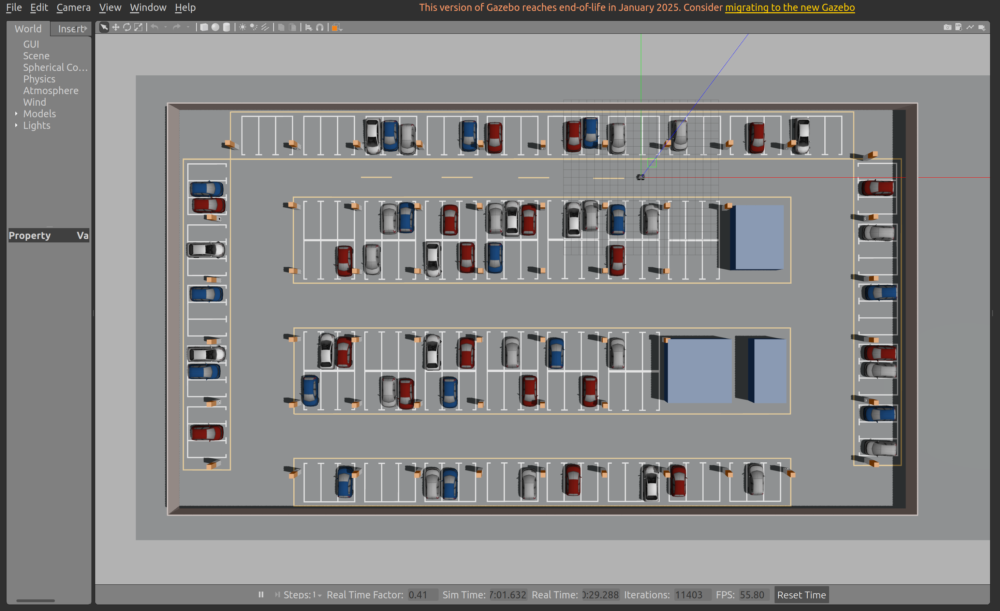
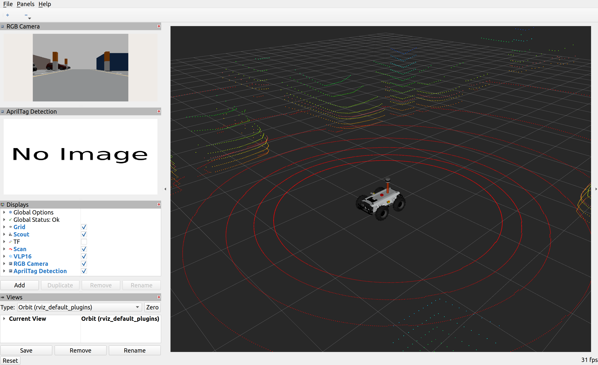
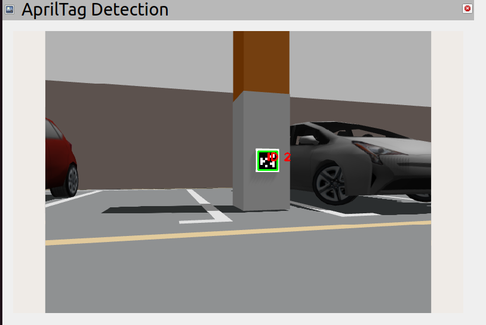
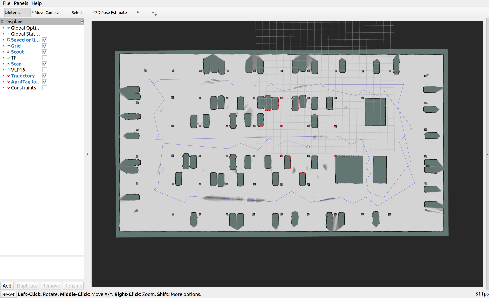
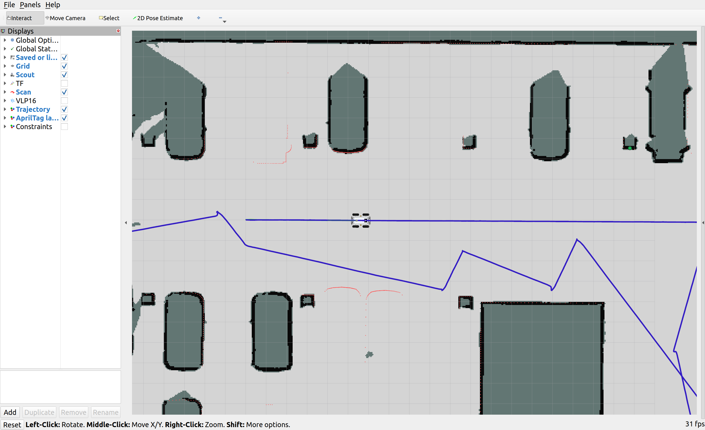

# Slam 建图教程

每个终端先加载环境（在slam文件夹下）：

```bash
source install/local_setup.bash
```

## 1.搭建仿真场景与导入机器人模型

使用建图的地图 `scene:=mapping`
```bash
ros2 launch scout_gazebo scout_gazebo.launch.py scene:=mapping
```




使用键盘控制运动，后加 `--ros-args -p speed:=0.3 -p turn:=0.4` 可控制直行与旋转速度
```bash
ros2 run teleop_twist_keyboard teleop_twist_keyboard
```

## 2.启动 AprilTag 检测

```bash
ros2 launch apriltag_ros continuous_detection.launch.py
```



## 3.Cartographer 建图定位

### 3.1 建图

启动建图环境
```bash
ros2 launch scout_gazebo scout_gazebo.launch.py scene:=mapping rviz:=false
```

启动 Cartographer 建图
```bash
ros2 launch scout_gazebo mapping.launch.py
```

启动键盘控制
```bash
ros2 run teleop_twist_keyboard teleop_twist_keyboard
```



保存地图至 /maps/mapping
```bash
ros2 run scout_gazebo save_map.py \
  --map /home/ubuntu22/study/slam/maps/mapping
```

## 3.2 定位

启动定位场景
```bash
ros2 launch scout_gazebo scout_gazebo.launch.py scene:=localization rviz:=false
```

