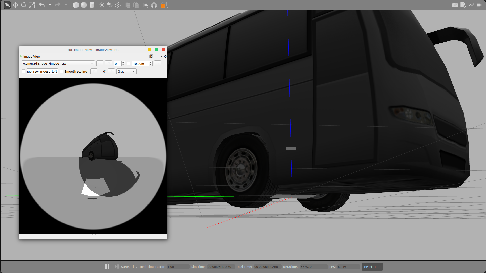
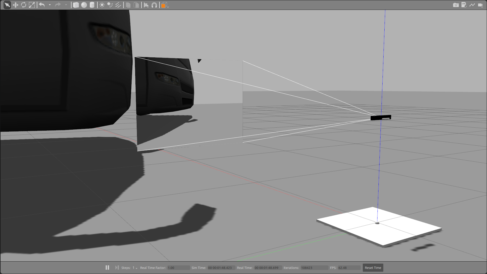
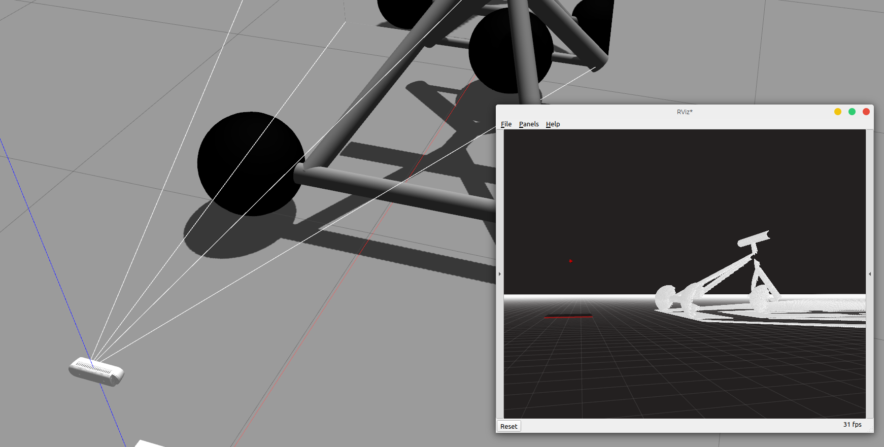

> 实验 9 ROS 2 适配说明：本包当前只安装几何资源和更新后的 D435 RGB-D Xacro，
> 使用系统 gazebo_plugins 的 ROS 2 相机插件，不编译原来的 ROS 1 C++ 插件。
> 当前支持 D435 外观的简化 RGB-D，不包含 IR 双目仿真。
> 下方为上游历史说明；本工作空间的启动与使用方法请参见 ../README.md。

# Intel RealSense Gazebo/ROS
Intel Realsense Tracking and Depth camera simulations and URDF macros.


## RealSense T265 ##



### Usage ###
```xml
<xacro:include filename="$(find realsense_ros_gazebo)/xacro/tracker.xacro"/>

<xacro:realsense_T265 sensor_name="camera" parent_link="base_link" rate="30.0">
  <origin rpy="0 0 0" xyz="0 0 0.5"/>
</xacro:realsense_T265>
```

### Publishers ###
* /camera/**fisheye1**/*
* /camera/**fisheye2**/*
* /camera/**gyro**/sample _( accel and gyro are in the same imu message )_
* /camera/**odom**/sample


## RealSense R200 ##



### Usage ###
```xml
<xacro:include filename="$(find realsense_ros_gazebo)/xacro/depthcam.xacro"/>

<xacro:realsense_R200 sensor_name="camera" parent_link="base_link" rate="30.0">
  <origin rpy="0 0 0" xyz="0 0 0.5"/>
</xacro:realsense_R200>
```

### Publishers ###

* /camera/**color**/*
* /camera/**depth**/*
* /camera/**infra1**/*
* /camera/**infra2**/*


## RealSense D435



### Usage ###

```xml
<xacro:include filename="$(find realsense_ros_gazebo)/xacro/depthcam.xacro"/>

<xacro:realsense_d435 sensor_name="d435" parent_link="base_link" rate="10">
  <origin rpy="0 0 0 " xyz="0 0 0.5"/>
</xacro:realsense_d435>
```

### Publishers ###

* /camera/**color**/*
* /camera/**depth**/*
* /camera/**infra1**/*
* /camera/**infra2**/*